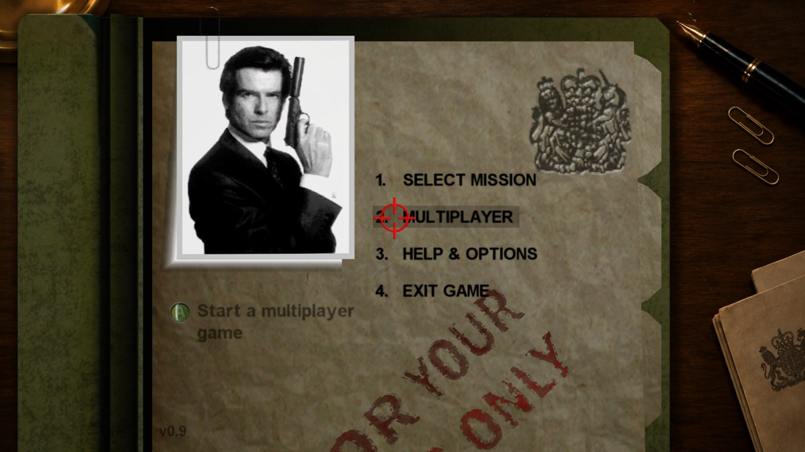
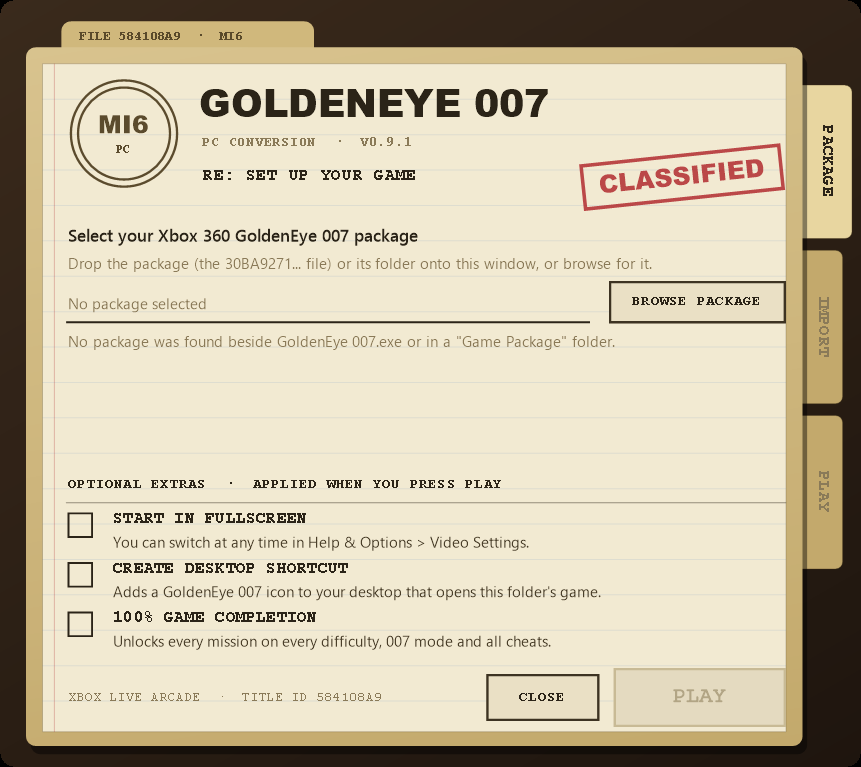
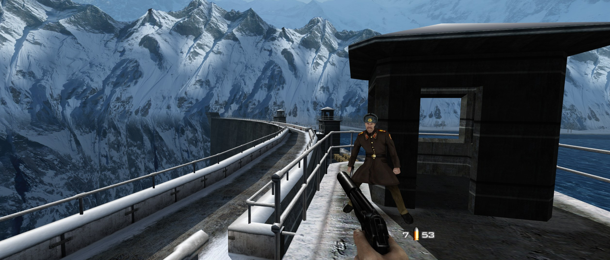
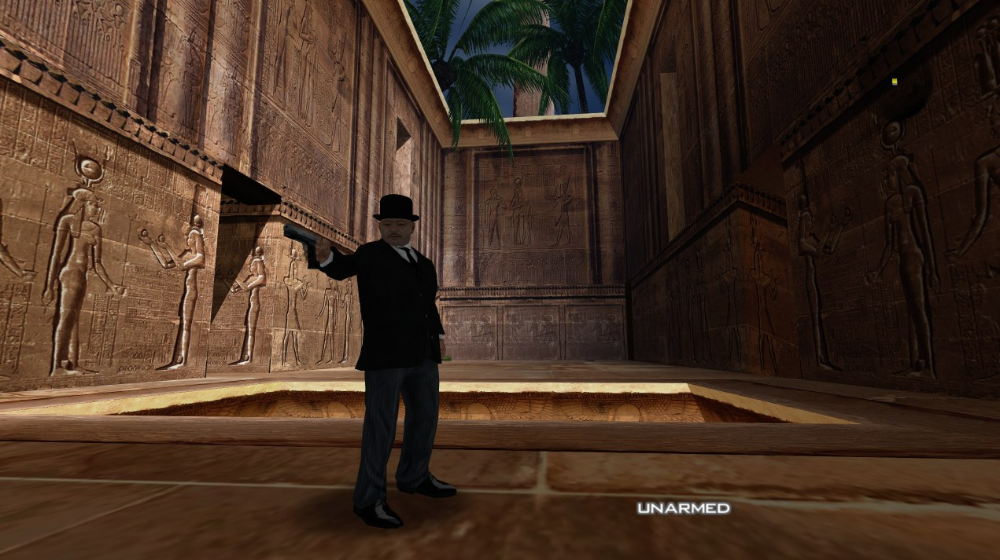

# GoldenEye 007 XBLA PC Recomp

A native Windows PC port of **GoldenEye 007**, based on the unreleased Xbox 360 remaster by Rare and 4J Studios, built using [ReXGlue](https://github.com/rexglue/rexglue-sdk) static recompilation.

Play at **up to 4K and 60 FPS**, with 16:9 and 21:9 widescreen support, enhanced graphics, keyboard and mouse controls, and LAN / Virtual LAN multiplayer. Switch between the original N64 and remastered graphics at any time. No emulator required.

**Free and open-source.**

> **You must provide your own copy of GoldenEye 007 XBLA.** No original game files or assets are distributed with this project. The launcher imports the required files from your Xbox 360 game package during first-time setup.

## Download & Installation

**[Download the latest release](https://github.com/CaiusCodes/GoldenEye-007-XBLA-PC-Recomp/releases)**

1. Download the latest ZIP and extract the **GoldenEye 007** folder.
2. Run `GoldenEye 007.exe`.
3. Select your GoldenEye 007 XBLA package using **Browse Package**, or place it alongside the executable for automatic detection.
4. Choose your preferred options, including fullscreen, desktop shortcut and optional 100% game completion.
5. Click **Play**.

After setup, simply run `GoldenEye 007.exe` to play. Your original game package is no longer needed.

**To reopen setup:** Hold **Shift** while launching, or select **Help & Options → Other Settings → Run Setup Again**.

The installation is portable, with imported game files, saves and settings stored inside the game folder.

### System Requirements

- Windows 10 or 11 (64-bit)
- DirectX 12 or Vulkan-compatible graphics card
- Integrated graphics supported, including Intel HD 620
- Your own GoldenEye 007 XBLA package (Title ID `584108A9`, supported build only)

## Features

### Graphics & Performance

- **Native PC Rendering:** DirectX 12 with automatic Vulkan fallback
- **Up to 4K resolution** with fullscreen and windowed modes
- **60 FPS** gameplay with V-Sync and optional FPS counter
- **Widescreen:** 4:3, 16:9 and 21:9 ultrawide
- **Render Scale:** 1x, 1.5x, 2x or 3x
- **AMD FSR** upscaling and texture filtering options
- **4x Anti-Aliasing** by default with the native renderer
- **Adjustable Field of View**, colour filters and Camera Bob toggle
- **Classic and Enhanced Graphics:** Switch instantly using F or RB

The native renderer significantly reduces CPU and GPU overhead compared with the previous renderer, making the game more accessible on older laptops and integrated graphics.

### Controls & Quality of Life

- Full **keyboard and mouse** support with rebindable keys and adjustable sensitivity
- **Xbox controller** support
- Native PC settings menus
- Optional 100% completion unlocks for missions, difficulties and cheats
- Improved aiming, including mouse-controlled tank turret and sniper zoom
- Optional FPS and frame-time counter
- Removed outdated Xbox Live menus and prompts
- Built-in update checker
- Portable installation with local saves and settings

### Multiplayer

- **LAN multiplayer** and online play through Virtual LAN services
- Compatible with Radmin VPN, ZeroTier, Tailscale and Hamachi
- Multiplayer music synchronised between players
- Fixes for map boundaries, collision, weapons and character selection

No Xbox Live connection is required.

## Keyboard & Mouse Controls

| Key | Action |
|---|---|
| W, A, S, D | Move |
| Mouse | Look / Aim |
| Left Click | Fire |
| Right Click | Aim / Precise Aim |
| E | Interact |
| R | Reload |
| Q | Cycle gadgets |
| Mouse Wheel | Switch weapons / Sniper zoom |
| F | Toggle original / enhanced graphics |
| Ctrl | Crouch |
| Tab | Objectives / Scores |
| Esc / Enter | Pause |
| Arrow Keys | D-pad |

Keys can be customised under **Help & Options → Keyboard & Mouse** or through the in-game watch menu.

Xbox controllers use the original console controls.

## Improvements & Fixes

Alongside the PC enhancements, several issues from the original unreleased build have been addressed:

- Fixed mission progression issues, including Cradle and Runway.
- Restored missing geometry and visual effects across several levels.
- Improved NPC behaviour, guard bodies and weapon effects.
- Fixed multiplayer collision issues in Bunker and Frigate.
- Fixed multiplayer shotgun damage and character selection problems.
- Corrected music playback, sound effects and menu issues.
- Removed obsolete Xbox Live functionality.
- Improved performance and stability on integrated graphics.

For detailed changes, see the [GitHub Releases](https://github.com/CaiusCodes/GoldenEye-007-XBLA-PC-Recomp/releases).

## Updates

Check for new versions through **Help & Options → Check for Updates**.

Updates are downloaded and installed without affecting your imported game files, saves or settings.

Alternatively, download the latest release ZIP and extract it over your existing installation.

Older installations using a separate setup executable and `Game` folder can also be imported during setup.

## Known Limitations

- Windows only.
- Only the supported GoldenEye 007 XBLA build (Title ID `584108A9`) is accepted.
- Some issues inherited from the original unreleased build may remain.
- Windows SmartScreen may warn about the unsigned executable.
- Windows Firewall may request permission for multiplayer connections.

**Renderer compatibility:** If you experience issues with the native renderer, the previous renderer can be enabled by setting `gpu_native = false` in `resources\userdata\ge.toml`.

## Reporting Issues

Found a bug? [Open a GitHub Issue](https://github.com/CaiusCodes/GoldenEye-007-XBLA-PC-Recomp/issues) and include your latest log from:

`resources\runtime\logs\`

**For performance, stuttering or freezing issues:**

1. Open `resources\userdata\ge.toml`.
2. Set `performance_diagnostics = true`.
3. Reproduce the issue and close the game.
4. Attach the latest `ge_NNN.log` to your report.
5. Set diagnostics back to `false` afterwards.

For NPC pathfinding or mission progression problems, use `npc_path_log = true` instead.

## Development & Credits

This project builds upon the work of:

- [GoldenEye Recomp](https://github.com/SunJaycy/GoldenEye-Recomp) by SunJaycy – Original ReXGlue recompilation.
- [GoldenEye Recomp Watch Music Fix](https://github.com/mrfox-1/GoldenEye-Recomp-Watch-Music-Fix) by mrfox-1 and contributors – Community fixes.
- BeanTools Community Edition – Original XBLA fixes.
- [ReXGlue](https://github.com/rexglue/rexglue-sdk) by Tom Clay and contributors – Static recompilation framework.
- [Plume](https://github.com/zolaware/plume) and [XenosRecomp](https://github.com/hedge-dev/XenosRecomp) – Native rendering and shader translation.

The project's own game-port code is released under [The Unlicense](LICENSE). The launcher includes GPL-3.0 components derived from [Velocity](https://github.com/hetelek/Velocity), and third-party dependencies retain their respective licences. See [packaging/licenses](packaging/licenses) and [packaging/licenses-native](packaging/licenses-native) for additional terms.

## Support Development

If you enjoy the project and would like to support future PC recompilation projects, you can [support me on Ko-fi](https://ko-fi.com/caiuscodes).

---

*GoldenEye 007, James Bond and Xbox are trademarks or property of their respective owners. This is an independent fan project and is not affiliated with or endorsed by the rights holders.*
