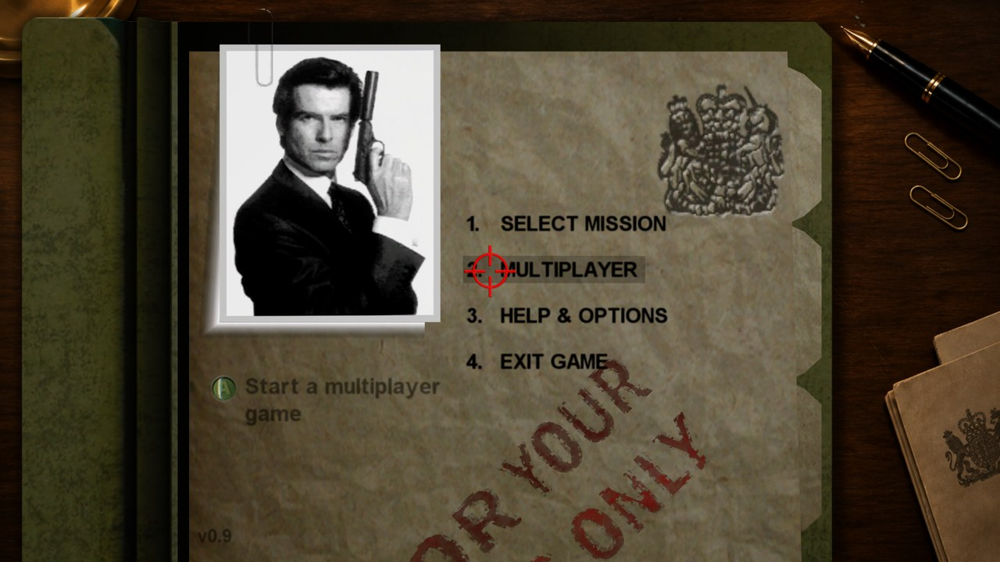
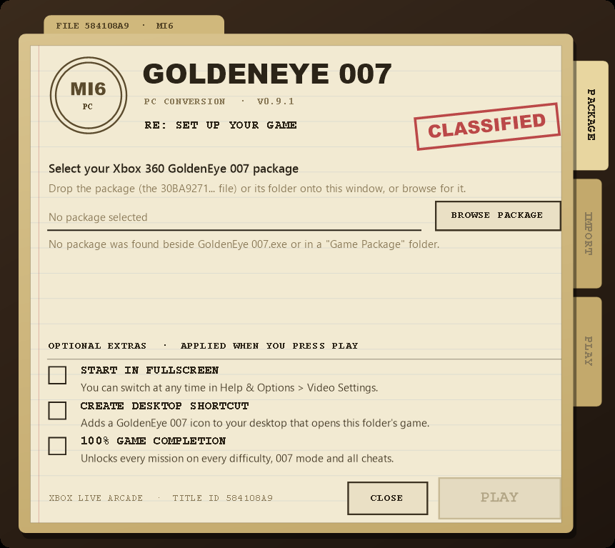
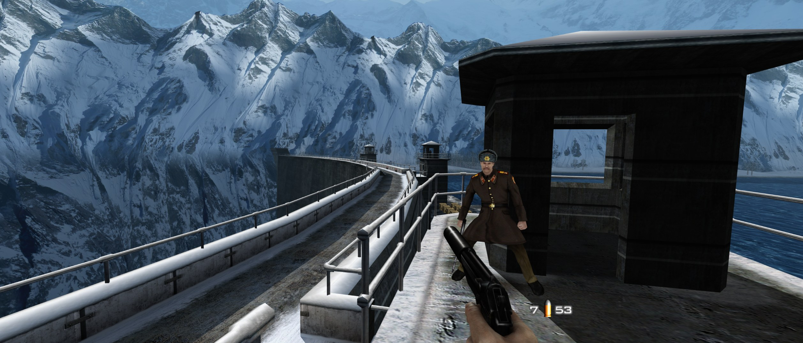
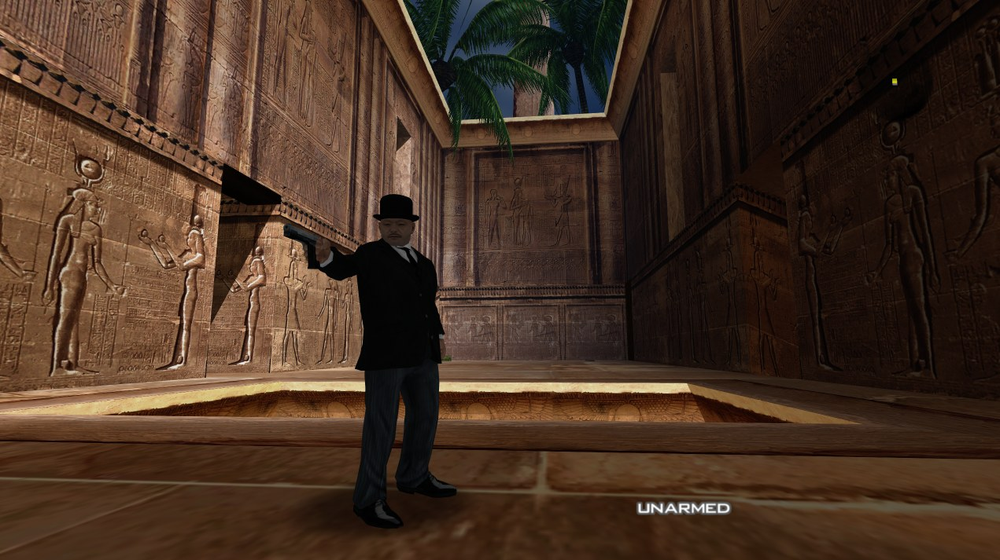
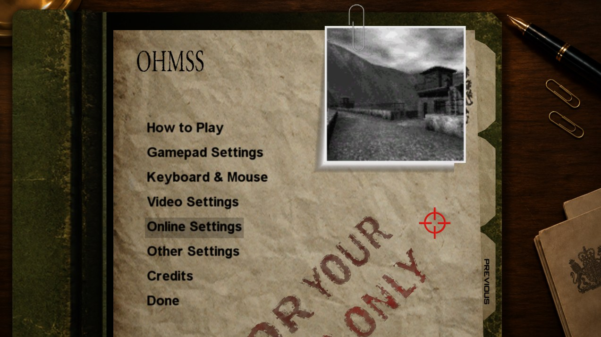
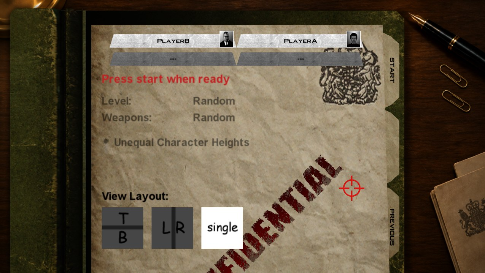

# GoldenEye 007 XBLA PC Recomp

A native Windows PC version of **GoldenEye 007** based on the unreleased
Xbox 360/XBLA remaster, created through static recompilation with
[ReXGlue](https://github.com/rexglue/rexglue-sdk). It runs at up to 4K with
16:9 and 21:9 widescreen at a steady 60 FPS and switches between the original and enhanced graphics at the
press of a key. Keyboard and mouse, Xbox controllers and online multiplayer
through LAN and virtual LAN services are all supported.

> **You need your own copy of GoldenEye 007 XBLA.** This project contains no
> original game executable, graphics, sound, music or other game data. The
> first time you start it, it reads the Xbox 360 GoldenEye 007 package you
> provide, checks that it is the supported version and imports the game data
> from it into the game's folder on your PC. This is different
> from the Bean build which had a fake build date only adding updated generic skydomes
> which did not match the level day/night and unlock rows which was common for most
> XBLA trial games.

Like the GoldenEye 007 XBLA PC Recomp and to support future
projects, you can tip me on [Ko-fi](https://ko-fi.com/caiuscodes).

[](https://ko-fi.com/caiuscodes)



## Requirements

- Windows 10 or 11, 64-bit
- A graphics card with DirectX 12 support
- Your own GoldenEye 007 Xbox Live Arcade package (the Xbox 360 game file for
  Title ID `584108A9`)

## Install and play

1. Download the latest release ZIP from the
   [Releases](https://github.com/CaiusCodes/GoldenEye-007-XBLA-PC-Recomp/releases)
   page and extract the **GoldenEye 007** folder to a location of your choice (not Program Files).
2. Open **GoldenEye 007.exe**. The first time, the setup window opens.
3. **Browse package** and select your game package or place the package file besides `GoldenEye 007.exe` or in
   a `Game Package` folder next to it and will be found and imported automatically.
7. Tick any optional extras: start in fullscreen, desktop shortcut, 100% game completion.
8. **Play**.



From then on opening `GoldenEye 007.exe` starts the game straight away; the
package is not needed again. Everything stays inside the extracted folder
(`resources\assets` for the imported game data, `resources\userdata` for user save data
and settings), so it can be moved or backed up as a whole.
Coming from an older release with `Setup GoldenEye 007.exe` and a `Game`
folder? Extract into or next to the old folder and setup imports straight
from the old install, saves and settings included.

Setup only reads your package and never changes it. It downloads nothing and
neither setup nor the game contacts Xbox Live.

## Features

- **Native Windows PC build**: no emulator, runs as a normal Windows program
- **Up to 4K**: windowed sizes from 1024×768 to 3840×2160, or fullscreen at
  your screen's resolution, rendered at twice the original resolution
- **Widescreen**: 16:9 and 21:9 (Screen Ratio in the game's options), with a
  desk backdrop around the menus on wide screens
  
- **Steady 60 FPS** (the game's own rate), with tear-free V-Sync and an
  optional FPS / frame-time counter
- **Original and enhanced graphics**: switch between the two at any time (F,
  or RB on a controller)
- **Keyboard and mouse**: mouse look, rebindable keys, mouse sensitivity,
  separate precise-aim sensitivity, invert look, mouse wheel zoom on the
  sniper rifle and the mouse in the menus and the pause watch
- **Xbox controller** support, working alongside keyboard and mouse
- **LAN multiplayer** (Multiplayer → LAN or Virtual LAN), and **online
  multiplayer** through virtual LAN services such as Radmin VPN, ZeroTier,
  Tailscale and Hamachi
  
- **Settings menu** (Help & Options): Keyboard & Mouse, Video Settings
  (display mode, window size, V-Sync, FPS counter, field of view,
  anti-aliasing, texture filtering, graphics API, post-processing filter)
  and Online Settings. Graphics API "Auto" uses Direct3D 12 on NVIDIA and
  Vulkan on AMD and other GPUs (Direct3D 12 crashes on AMD with this game)
  
- **Wider field of view** (10 degrees wider by default, adjustable from the
  original up to +30)
- Optional **100% game completion** in setup: every mission, difficulty,
  007 mode and cheat unlocked
- **Portable**: one program to open, no installer, no administrator rights;
  saves and settings stay in the game folder
  

### Controls

| Key / button | Action |
|---|---|
| W, A, S, D | Move |
| Mouse | Look and aim; moves the crosshair in menus |
| Left click | Fire |
| Right click | Aim and precise aim; back in menus |
| E | Activate (A button); select in menus |
| Q | Cycle gadgets |
| R | Reload |
| Mouse wheel | Cycle weapons; zoom while aiming the sniper rifle |
| F | Toggle graphics (original / enhanced) |
| Ctrl | Crouch |
| Escape, Enter | Start: pause with the watch menu; Escape is back in menus |
| Tab | Objectives / scores |
| Arrow keys | D-pad |

Keys can be changed in Help & Options → Keyboard & Mouse, or on the watch's
Keyboard Controls page during a mission. An Xbox controller works as on the
console.

### Fixes implemented so far

- Removed the beta text on the logo screen and the blur in original graphics mode.
- Dam intro camera fix.
- Level bug fix, guards spawning without weapons on Runway.
- Frigate's water now drawn correctly in enhanced graphics, including near the speedboat.
- Frigate, five invisible locked doors that blocked walkways are now normal doors that open both ways (multiplayer).
- Frigate, both small balconies can be walked onto and players can drop off the large ledge onto the deck below (multiplayer).
- Bunker: the entrance out to the snow is walled off again, so players can’t leave the map (multiplayer).
- Music fixed watch/pause theme, Mission Select music after a mission ends and the Control and Caverns elevator music which now resumes where it left off.
- Dead guards fade out increased from 1.5 seconds to 1 minute.
- Tank turret aiming with the mouse.
- Fixed two different characters both being called "Scientist" on character select.
- Fixed multiplayer characters icons "?" now show character models in character select.
- Fixed Bond and the Russian infantry guard showing two heads with old graphics.
- Removed Xbox-only messages that don't apply on PC.
- Removed Xbox LIVE-only menu entries and the player card's View Gamercard and Add To Friends List rows which led nowhere.
- Every player now hears the same music in LAN matches.
- Fixed the watch volume sliders' range and door sounds that went silent at a distance.
- Fixed LAN games not finding each other over virtual LAN adapters such as Radmin VPN and Hamachi, or on PCs with several network adapters.
- Fixed the automatic shotgun's muzzle flash showing all the time on guns held by players and lying on the floor.
- Fixed shotgun and automatic shotgun shots never reaching other players in multiplayer.
- Other Misc fixes.

## Known limitations

- Windows only for now.
- Only the GoldenEye 007 Xbox Live Arcade package with Title ID `584108A9`
  and the exact game program this port was recompiled from is supported;
  setup refuses other builds.
- The game is not digitally signed, so Windows SmartScreen may warn the first
  time; choose *More info* → *Run anyway*. Windows also asks for network
  access the first time you host or join a LAN game.
- Issues remaining relating to the original build.

**If something goes wrong include the newest files from
`resources\runtime\logs` when reporting it.**

## For Developers

Building from source. You need Git, CMake 3.25 or newer, Ninja, LLVM/Clang 18
or newer (installed in `C:\Program Files\LLVM`), Python 3, Visual Studio 2022
or newer with the C++ workload (Windows SDK and the Visual C++ runtime that
releases ship) and Windows PowerShell, plus your own GoldenEye 007 package.

ReXGlue is the `rexglue-sdk` submodule, pinned to upstream v0.10.0. This
project's changes to it, including the GoldenEye Recomp ReXGlue fork, are kept
in `patches/rexglue.patch`, which CMake applies automatically. ReXGlue's
dependencies are nested deeply, so enable long paths when cloning:

```powershell
git -c core.longpaths=true clone --recurse-submodules --shallow-submodules https://github.com/CaiusCodes/GoldenEye-007-XBLA-PC-Recomp.git
```

Extract your package into `game/`, generate the recompiled code from your own
`default.xex`, then build the game:

```powershell
.\tools\Extract-STFS.ps1 -Path <your package> -OutputDir game
cmake --preset win-amd64-release
cmake --build --preset win-amd64-release --target ge_codegen
cmake --preset win-amd64-release
cmake --build --preset win-amd64-release
```

The `ge_codegen` step builds ReXGlue's code generator and translates
`game/default.xex` into C++ in `generated/`; the second configure picks that
code up. Later builds rerun the generator by themselves when its inputs
change. The generated code is derived from the game, so it is never committed
(only the SDK boilerplate `generated/rexglue.cmake` is); `ge_config.toml`
holds the function addresses and hooks the generator uses.

The game is built to `out/build/win-amd64-release/GoldenEye 007.exe`. To run it
from there, link your extracted package in as its `assets` folder:

```powershell
New-Item -ItemType Junction -Path "out\build\win-amd64-release\assets" -Target game
```

### macOS (Apple Silicon)

The same steps work on macOS with Xcode's command line tools (AppleClang 16
or newer), `brew install cmake ninja` and Python 3. The game renders through
Vulkan on MoltenVK, which the build places next to it. PowerShell is not
needed: `tools/extract_stfs.py` is the same extractor in Python.

```bash
python3 tools/extract_stfs.py <your package> game
cmake --preset mac-arm64-release
cmake --build --preset mac-arm64-release --target ge_codegen
cmake --preset mac-arm64-release
cmake --build --preset mac-arm64-release
ln -sfn ../../../game "out/build/mac-arm64-release/assets"
"out/build/mac-arm64-release/GoldenEye 007"
```

A setup window comes up before the game starts (graphics, controls, key
bindings); untick "Show this window at start" or set `ge_show_setup = false`
to skip it. If the frame rate is low, set the internal resolution to 1x there
(in testing, 1x ran at about 60 FPS where the default 2x ran at about 15).

The macOS port is new and still has known issues. Faint dotted lines can show
along some triangle edges: Apple GPUs give unusable texture coordinate
derivatives at edge pixels with MSAA, and the workaround in the SDK patch
(`quad_robust_texture_derivatives`) removes most but not all of them.
Fullscreen can come up black; the game starts windowed by default.

ReXGlue's developer hotkeys (F3 debug overlay, backtick console, F4 settings
overlay, F7 achievements overlay) are off. Set `developer_hotkeys = true` in
`ge.toml` to bring them back; `ge_debug_menu = true` enables the game's hidden
debug menu (press F9 in a mission, or set another key with `ge_debug_menu_key`,
for example `ge_debug_menu_key = "F10"`).

`.\tools\Make-Release.ps1` (or `Make Release.bat`) builds the release ZIP,
`out\release\GoldenEye-007-XBLA-PC-Recomp-v<version>.zip`. It holds one
`GoldenEye 007` folder with the launcher (`GoldenEye 007.exe`, built from
`packaging/launcher` by `packaging/Build-Launcher.ps1`), README, licences and
`resources\runtime` (the game and its DLLs), and never any game data. The
version comes from the `VERSION` file.

## Licence and credits

This project is built on the work of others:

- [GoldenEye Recomp](https://github.com/SunJaycy/GoldenEye-Recomp) by
  SunJaycy, the original ReXGlue recompilation of GoldenEye 007 this port is
  based on (The Unlicense), and his
  [ReXGlue fork](https://github.com/SunJaycy/GoldenEye-Recomp-rexglue)
  (BSD 3-Clause), whose runtime fixes are part of `patches/rexglue.patch`.
- [GoldenEye Recomp Watch Music Fix](https://github.com/mrfox-1/GoldenEye-Recomp-Watch-Music-Fix)
  by mrfox-1 and contributors: music, tank, body-fading, Frigate water and
  menu fixes (MIT, see [LICENSE-community-fixes-MIT.txt](LICENSE-community-fixes-MIT.txt)).
- The BeanTools Community Edition GoldenEye XBLA fixes, which GoldenEye Recomp
  carries over as code and changed values.
- [ReXGlue](https://github.com/rexglue/rexglue-sdk) by Tom Clay and
  contributors (BSD 3-Clause), which includes code derived from
  [Xenia](https://xenia.jp).

This project's own code is released under The Unlicense, like GoldenEye
Recomp (see [LICENSE](LICENSE), which also lists what it does not cover).
The STFS package reader (`packaging/launcher/stfs.cpp` and
`tools/Extract-STFS.ps1`) is derived from
[Velocity](https://github.com/hetelek/Velocity) and is GPL-3.0, so the
launcher it is compiled into (`GoldenEye 007.exe` in the release root) is
distributed under the GPL-3.0; the game itself is a separate program. ReXGlue and
its third-party libraries keep their own licences; see
[packaging/licenses](packaging/licenses).

GoldenEye 007, James Bond, Xbox and Xbox 360 are trademarks or property of
their respective owners. This is an unofficial fan project, not affiliated
with or endorsed by them.
